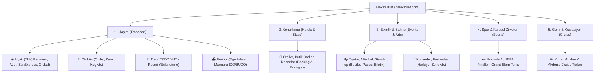

# 🏛️ HAKİKİ BİLET — MASTER REFERANS DÖKÜMANI (PRD & PLATFORM ANAYASASI)

> **Sürüm:** 1.0 (Canlı)  
> **Son Güncelleme:** Ekim 2026  
> **Alan Adı:** [hakikibilet.com](https://hakikibilet.com)  
> **Slogan:** *"Hakiki Fiyat, Hakiki Bilet"*  
> **Bu Dökümanın Amacı:** Hakiki Bilet platformunu geliştiren, güncelleyen veya mimarisini genişleten tüm yapay zekalar (Claude, Gemini, GPT vb.) ve yazılım geliştiriciler için **TEK VE DEĞİŞMEZ REFERANS KAYNAĞI (Single Source of Truth)** niteliğindedir. Bu dökümanda belirtilen felsefe, ticari kurallar ve teknik standartlar çiğnenemez.

---

## 1. MARKA KİMLİĞİ VE STRATEJİK VİZYON

### 1.1. Nihai Amaç (Top-of-Mind Awareness)
Kullanıcı seyahat etmek, bir yere gitmek ya da bir etkinliğe katılmak istediğinde **aklına gelecek İLK ve TEK bilet arama motoru** olmak.
* Kullanıcı 10 farklı siteyi (Enuygun, Biletix, Passo, Obilet, Booking, havayolu siteleri vb.) tek tek gezmek yerine Hakiki Bilet'e gelir.
* Hakiki Bilet; aranan her bilet için **en ucuz, en güvenilir ve en avantajlı** seçeneği canlı olarak kıyaslar.

### 1.2. Kırmızı Çizgimiz (Radikal Şeffaflık İlkesi)
* **Asla Sahte İndirim Yok:** Sitede 1.000 TL gösterip, sağlayıcıya yönlendirildiğinde 1.500 TL çıkaran yanıltıcı kurgular kesinlikle yasaktır.
* **Teyitsiz Fiyat Göstermeme Kuralı:** Eğer bir sağlayıcıdan (örneğin Trip.com veya Turna) API ile doğrulanmış canlı anlık fiyat çekilemiyorsa, o karta rastgele veya eski fiyat yazılmaz. Bunun yerine şeffaf bir şekilde **"Trip.com Canlı Fiyatı Gör ↗"** gibi dinamik yönlendirme etiketleri kullanılır.
* **Hukuksal Güvence (TÜRSAB 1618 Metasearch Muafiyeti):** Hakiki Bilet doğrudan bilet satmaz, kredi kartı bilgisi toplamaz, ödeme tahsil etmez. Satış sorumluluğu yönlendirilen akredite kurumdadır.

---

## 2. TİCARİ STRATEJİ VE GELİR MODELİ (MONETİZASYON ANAYASASI)

> [!IMPORTANT]
> **TEMEL TİCARİ KURAL:** Hakiki Bilet'in varlık sebebi kullanıcısına dürüst hizmet sunarken **yönlendirme başına komisyon geliri** elde etmektir. Komisyon alamayacağımız yönlendirmeler her zaman İKİNCİL plandadır!

### 2.1. Öncelik Sıralaması (Prioritization Hierarchy)
1. **1. Öncelik (Komisyonlu Satış Ortakları):**  
   Bize doğrudan satış komisyonu veya tıklama geliri getiren anlaşmalı sağlayıcılar (Trip.com, Enuygun, Booking.com, Travelpayouts / Aviasales, Obilet, Bubilet vb.) her zaman **birincil buton, en belirgin CTA ve öne çıkan seçenek** olacaktır.
2. **2. Öncelik (Komisyonsuz Resmi Sağlayıcılar):**  
   Doğrudan havayolu kendi sitesinden (örneğin THY veya Pegasus doğrudan web sitesi) komisyon alınamıyorsa; aynı uçuşu satan ve bize komisyon veren partner (örneğin Enuygun veya Trip.com) ana buton yapılır; resmi havayolu sitesi ise sadece güven pekiştirici ikincil bir seçenek ("Resmi Web Sitesi") olarak sunulur.

### 2.2. Takip Kodları (Affiliate Parameters) Entegrasyon Zorunluluğu
Üretilen her derin linkte Hakiki Bilet'in gelir ortaklığı parametreleri eksiksiz yer almalıdır:
* **Travelpayouts / Aviasales:** Marker: `585474`
* **Booking.com:** AID: `585474` (veya ilgili affiliate ID)
* **Enuygun / GelirOrtakları:** SubID: `hakikibilet`
* **Trip.com:** Alliance ID (AID) & SID: `hakikibilet`
* **Obilet / Yolcu360:** SubID: `hakikibilet`
* **Bubilet / Biletix / Passo:** Anlaşmalı affiliate / kampanya ref kodları.

### 2.3. Derin Linkleme Kuralı (Deep-Link Precision)
* **Kullanıcı Kaybını Önleme:** Hiçbir yönlendirme ilgili firmanın ana sayfasına boş şekilde bırakılamaz!
* Kullanıcı Hakiki Bilet'te *"31 Ekim SAW-ADB 08:20 Pegasus"* biletini seçtiğinde; ilgili partnerin doğrudan **o tarihteki, o kalkış-varıştaki, o saatteki ve o yolcu sayısındaki biletleme/ödeme adımına** düşmelidir.

---

## 3. ÜRÜN VE DİKEY KAPSAMI (SUPER-AGGREGATOR)

Hakiki Bilet hayatın bilet gerektiren her alanını kapsayan 5 ana dikeyde çalışır:

### 3.1. Ulaşım Modları
* **Uçak Bileti:** Yurt içi 55+ teyitli havalimanı ve tüm dünya metropolleri. Canlı Google Flights RPC motoru ile anlık seferler, uçak modelleri ve fiyatlar.
* **Otobüs:** Türkiye'nin tüm illeri ve otogarları arası güzergahlar.
* **Tren:** TCDD Yüksek Hızlı Tren ve ana hatlar. *(Özel Not: TCDD EYBİS sistemi kapalı devre olduğundan sadece resmi bilet alma sayfasına yönlendirilir).*
* **Feribot & Ada Hatları:** Çeşme-Sakız, Ayvalık-Midilli, Bodrum-Kos, Kuşadası-Samos ve Marmara hatları.
* **Kruvaziyer (Cruise):** Çeşme, Kuşadası ve İstanbul çıkışlı Yunan Adaları ve Akdeniz cruise paketleri.

### 3.2. Konaklama (Otel & Tatil)
* Booking.com ve Enuygun canlı metasearch altyapısı.
* Uçuş araması yapıldığında varış şehrine göre otomatik otel çapraz önerisi (Cross-sell).
* Yurt dışı / Ege Adaları güvenliği (Enuygun 404 hatası vermemesi için adalarda yalnızca Booking.com / Agoda devreye girer).

### 3.3. İlham & Teşvik Motoru (Event-Driven Travel)
Sadece arama kutusu sunan pasif bir site değil; kullanıcıda seyahat arzusu uyandıran akıllı öneri motoru:
* **Hafta Sonu Kaçamakları:** *"Cuma çıkışlı 2 günlük vizesiz Sakız Adası kaçamağı!"*
* **Özel Gün & Festival Alarmları:** *"Yakında Cadılar Bayramı (Halloween) / Yılbaşı yaklaşıyor, biletler açıldı tükenmeden kapın!"*
* **Büyük Sahne Takvimleri:** *"Harbiye Açık Hava Sezonu açıldı; şehir dışından gelenler için uçuş + Taksim oteli tek tıkla hazır!"*
* **Akıllı FOMO Sayaçları:** *"⏳ Son 28 Gün • Bilet ve otel fiyatları fırlamadan yerinizi ayırtın."*

---

## 4. TEKNİK MİMARİ VE SİSTEM ALTYAPISI

### 4.1. Teknoloji Yığını (Tech Stack)
* **Backend:** Python 3.12+ / 3.14, FastAPI, Pydantic v2, Uvicorn (ASGI).
* **Frontend:** Jinja2 Şablonları (`index_v2.html`), Tailwind CSS (Modern responsive utility-first), Vanilla Modern JavaScript (`app_v2.js`), FontAwesome 6 Pro/Free simgeleri.
* **Veri & Kazıma (Scraping) Katmanı:**
  * `fast_flights` + Google Flights Dinamik RPC İmzaları (`live_flights.py`): Pegasus, AJet, THY ve SunExpress gerçek sefer saatleri, IATA kodları (PC 2182 vb.), uçak tipleri (Airbus A321 vb.) ve canlı fiyatları.
  * RapidAPI Booking.com Canlı Otel Entegrasyonu (`hotel_service.py`) + 2 saatlik TTL bellek önbelleği.
* **Veritabanı (Persistence):** SQLite (`data/ucuz_bilet.db`): Fiyat alarmları (`trackers`), bülten erken kayıtları (`erken_kayit`), sistem logları.
* **E-posta & Bildirim:** Resend API (`notification_service.py`) kurumsal e-posta gönderimi (`info@hakikibilet.com`).
* **DevOps & Dağıtım:**
  * Depo: GitHub (`turkersezer/hakikibilet` - `main` dalı).
  * Hosting: Render Web Service (`render.yaml`, `Procfile`).
  * CDN / Güvenlik: Cloudflare SSL & Dinamik Önbellek.

### 4.2. Çoklu Dil Motoru (TR / EN i18n)
* Sitedeki 58+ arayüz öğesi, tüm arama formu, etkinlik kartları, tarihler, rozetler, butonlar ve Radar bülteni sayfa yenilenmeden tek tıkla anında İngilizce ve Türkçe arasında geçiş yapar.
* Ziyaretçinin tercihi tarayıcıda `localStorage: hakiki_lang` olarak saklanır. Ziyaretçi daha sonra geldiğinde site hatırlanan dilde açılır.

---

## 5. OTOMATİK ETKİNLİK & RADAR SİSTEMİ MİMARİSİ

Yeni etkinlik, konser ve festivallerin sisteme eklenmesi 3 aşamalı otomatik bir kurgu ile çalışır:

1. **Etkinlik Tarayıcı Servisi (Crawler / Cron):** Bubilet, Passo, Biletix, Formula 1 resmi biletleme portallarını ve federasyon takvimlerini periyodik olarak tarar.
2. **Doğrulama & Filtreleme (Kırmızı Çizgi Koruması):** Yalnızca federasyon veya resmi organizatör tarafından teyit edilmiş, bilet satışı başlamış ya da kesinleşmiş organizasyonlar içeri alınır. Kulaktan dolma tarihler listelenmez.
3. **Otomatik Dil & FOMO Üretimi:** Eklenen her etkinliğin `title_en`, `desc_en`, `dates_en`, `urgency_badge_en` alanları otomatik oluşturulur; etkinlik tarihine kalan güne göre aciliyet rozeti (Son X Gün) dinamik hesaplanır.

---

## 6. GELECEKTEKİ GELİŞTİRİCİLER VE YAPAY ZEKALAR İÇİN ZORUNLU KURALLAR

1. **Komisyon Getiren Linkleri Asla İkinci Plana Atma:** Yeni bir entegrasyon eklerken veya arayüzü güncellerken, gelir getiren butonlar her zaman en dikkat çekici konumda olmalıdır.
2. **Sağlayıcıda Olmayan Fiyatı Karta Yazma:** Bir sağlayıcının canlı fiyatı doğrulanmadıysa, asla tahmini rakam yazma. Her zaman *"Canlı Fiyatı Gör ↗"* etiketini kullan.
3. **Deep-Linkleri Parametresiz Bırakma:** Kullanıcıyı yönlendirirken partnerin ana sayfasına gönderme; mutlaka kalkış, varış, tarih, kişi ve sefer ID parametrelerini iliştir.
4. **Çift Dil Desteğini Bozma:** Yeni eklenen her metin, buton, kart ve bülten hem Türkçe (`TR`) hem İngilizce (`EN`) karşılıklarıyla birlikte tanımlanmalıdır.
5. **Bakım & Canlı Güvenliği:** `MAINTENANCE_MODE=false` olarak kalmalı, canlıya alımlar `git push origin main` ile Render üzerinden test edilerek sürdürülmelidir.

---

*Bu döküman Hakiki Bilet projesinin Anayasasıdır. Tüm yeni özellikler, iyileştirmeler ve refaktörler bu dökümandaki prensiplere sadık kalınarak icra edilir.*
