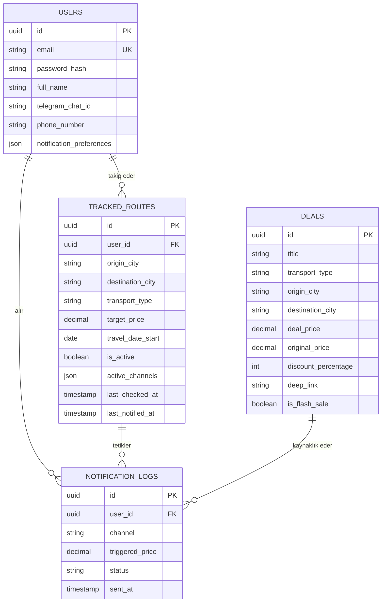

# 🧭 Net Rota — Uçak, Otobüs, Tren & Araç Kiralama Karşılaştırma ve Fiyat Takip Portalı

Türkiye'deki seyahat severler için geliştirilmiş; **uçak**, **yüksek hızlı tren (TCDD)**, **otobüs** biletlerini ve **araç kiralama** seçeneklerini tek bir ekranda karşılaştıran, fiyat düşüşlerini arka planda periyodik olarak tarayan ve hedef fiyat yakalandığında **E-Posta**, **Tarayıcı Push** veya **Telegram** üzerinden anlık bildirim gönderen akıllı seyahat karşılaştırma platformu.

---

## 🌟 Öne Çıkan Özellikler

### 1. Modül 1 — Akıllı Arama & Parametreli Yönlendirme (Deep-Link)
* **Uçak Bileti:** Skyscanner, Google Flights ve Enuygun sistemlerine otomatik tarih, yolcu ve IATA kodlarıyla derin link oluşturma.
* **Tren Bileti:** TCDD E-Bilet (YHT) doğrudan istasyon eşleme ve bilet sorgulama ekranına aktarım.
* **Otobüs Bileti:** Obilet, Kamil Koç ve Pamukkale Turizm seferlerine tek tıkla parametreli yönlendirme.
* **81 İl Desteği:** Türkiye'deki tüm iller, havalimanları (IST, SAW, ESB, ADB, AYT...) ve YHT garları entegredir.

### 2. Modül 2 — Fiyat Takibi & Kampanya Algılama
* **Hedef Fiyat Alarmı:** "İstanbul → Ankara bileti 500 ₺ altına inince bana haber ver".
* **Periyodik Nöbetçi Tarama:** Arka plandaki Cron zamanlayıcısı (her 1-6 saatte bir) fiyatları ve flaş indirimleri otomatik sorgular.
* **Spam & Gece Koruması:** Kullanıcıların gece sessiz saatlerinde (örn. 23:00 - 08:00) rahatsız edilmemesi ve aynı bilet için 6 saat boyunca mükerrer bildirim gitmemesi için akıllı filtreleme.

### 3. Modül 3 — Çok Kanallı Bildirim Sistemi
* **📧 Zengin HTML E-Posta:** Resend / SendGrid API entegrasyonu ile mobil uyumlu, rota, tasarruf miktarı ve "Hemen Al" butonlu bildirimler.
* **📱 Web Push (Tarayıcı Bildirimi):** Service Worker destekli; web sitesi açık veya kapalıyken masaüstü/mobil ekrana anlık düşen bildirimler.
* **📲 Telegram Botu:** Telegram Bot API üzerinden saniyeler içinde zengin Markdown formatlı indirim mesajı ve butonlar.
* **💬 WhatsApp (Twilio):** Twilio REST API entegrasyonu ile WhatsApp Business mesaj desteği.

### 4. Modül 4 — Kullanıcı & Takip Paneli
* Kullanıcının takip ettiği rotalar, hedef fiyatlar, kanal tercihleri.
* Rotayı tek tıkla duraklatma, yeniden aktifleştirme ve silme.
* Bildirim geçmişi kayıtları (ne zaman hangi fiyat için uyarı verildi).
* Bildirim kanallarını anlık test edebilme konsolu.

### 5. Modül 5 — Güncel Fırsatlar & Flaş İndirimler Vitrini
* Pegasus, THY, AJet, TCDD ve Obilet üzerinden yakalanan anlık promosyonlar.
* Uçak / Tren / Otobüs filtreleri.
* Tek tıkla bilet sayfasına yönlendirme veya tek tıkla rotayı takibe alma.

---

## 🏗 Sistem Mimarisi & Veritabanı Şeması



---

## 🚀 Hızlı Kurulum & Çalıştırma

### 1. Gereksinimler
* Python 3.10+
* Git (opsiyonel)

### 2. Bağımlılıkları Yükleyin
```bash
pip install -r requirements.txt
```

### 3. Çevre Değişkenlerini Ayarlayın (Opsiyonel)
`.env.example` dosyasını `.env` olarak kopyalayabilir ve API anahtarlarınızı girebilirsiniz:
```bash
# Windows PowerShell
cp .env.example .env
```

### 4. Uygulamayı Başlatın
```bash
python run.py
```

Tarayıcınızda açın:
* **Ana Sayfa (Arama & Fırsatlar):** [http://localhost:8000](http://localhost:8000)
* **Kullanıcı Paneli (Takipler & Test):** [http://localhost:8000/dashboard](http://localhost:8000/dashboard)
* **Swagger API Dokümanı:** [http://localhost:8000/docs](http://localhost:8000/docs)

---

## ⚙️ Bildirim Kanalları Yapılandırma Rehberi

### 1. Resend (E-Posta) Kurulumu
1. [resend.com](https://resend.com) üzerinden ücretsiz hesap açın.
2. API Keys bölümünden anahtarınızı kopyalayın.
3. `.env` dosyasına `RESEND_API_KEY=re_your_key` olarak ekleyin.
*(Not: Anahtar girilmediğinde sistem güvenli simülasyon modunda çalışır ve gönderilen e-posta şablonunu konsola loglar).*

### 2. Telegram Bot Kurulumu
1. Telegram'da `@BotFather` ile konuşarak `/newbot` komutuyla botunuzu oluşturun.
2. Verilen HTTP API Token'ı `.env` dosyasına `TELEGRAM_BOT_TOKEN=...` olarak ekleyin.
3. Botunuza `/start` mesajı atın ve chat id'nizi Kullanıcı Paneli'ne girin.

### 3. Tarayıcı Push (Web Push)
* Tarayıcıda siteye ilk girdiğinizde üstteki banner'dan veya Kullanıcı Paneli'nden **"Bildirimlere İzin Ver"** butonuna tıklamanız yeterlidir.
* Service Worker arka planda bildirimleri doğrudan işletim sistemi bildirim merkezine iletir.

---

## ⏰ Cron Job Zamanlamaları

Uygulama içerisinde dahili olarak `APScheduler (AsyncIOScheduler)` çalışmaktadır:

| Görev | Varsayılan Aralık | Açıklama |
| :--- | :--- | :--- |
| **Fiyat & Kampanya Taraması** | Her 2 Saatte Bir (`interval: 2h`) | Pegasus, AJet, TCDD ve Obilet duyurularını ve takip listesindeki rotaların güncel bilet fiyatlarını sorgular. |
| **Spam / Cooldown Kontrolü** | 6 Saatlik Pencere | Aynı rota için 6 saat geçmeden tekrar tekrar e-posta/telegram atılmasını engeller. |
| **Sessiz Saatler** | 23:00 - 08:00 | Kullanıcı panelinde belirlenen gece saatlerinde bildirimler sessize alınır. |
| **Anlık Tetikleme (Manuel)** | İstendiğinde | Kullanıcı Paneli'ndeki `Fiyat Taramasını (Cron) Şimdi Tetikle` butonu ile anında çalıştırılabilir. |

---

## ☁️ Dağıtım (Deployment)

### Railway / Render
1. Depoyu Railway veya Render'a bağlayın.
2. Build Command: `pip install -r requirements.txt`
3. Start Command: `uvicorn app.main:app --host 0.0.0.0 --port $PORT`
4. Environment Variables kısmına `.env` içeriğini ekleyin.

### Docker
```dockerfile
FROM python:3.11-slim
WORKDIR /app
COPY requirements.txt .
RUN pip install --no-cache-dir -r requirements.txt
COPY . .
CMD ["uvicorn", "app.main:app", "--host", "0.0.0.0", "--port", "8000"]
```
