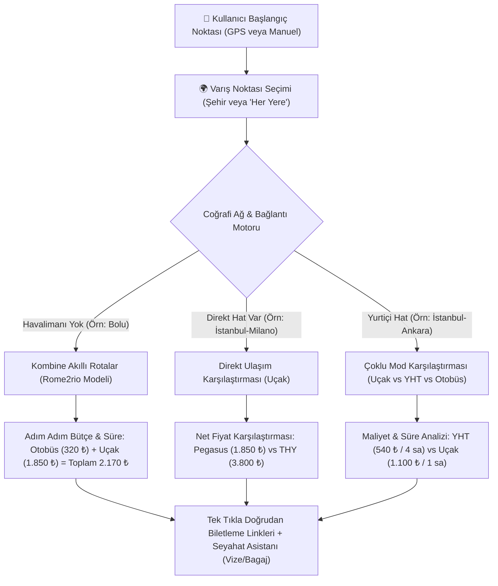
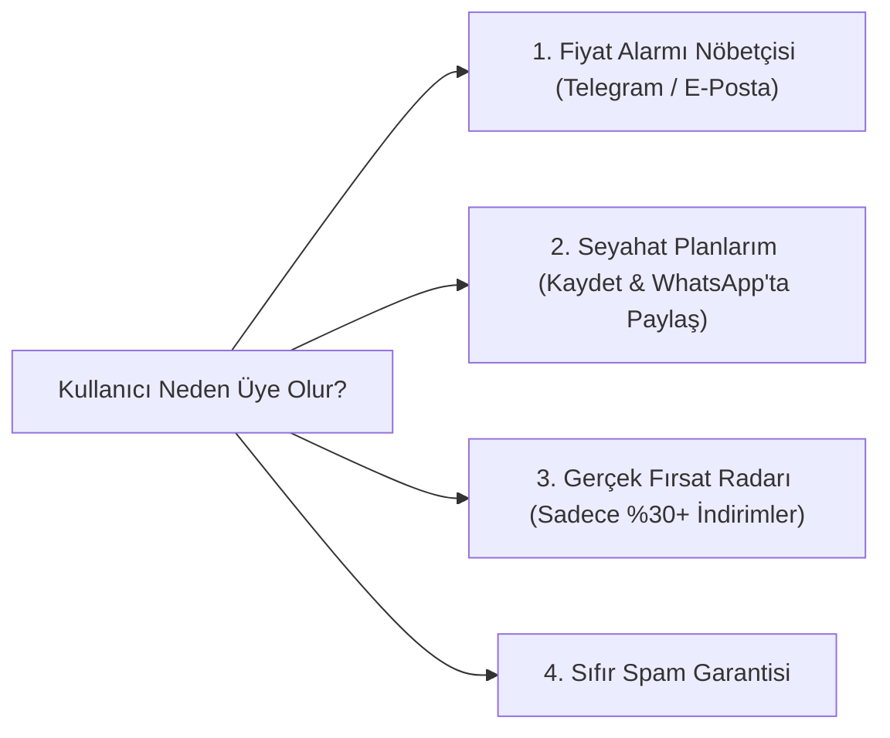

# 🧭 Net Rota: Stratejik Dönüşüm ve Uçtan Uca Seyahat Planlama Raporu

Bu doküman; **kullanıcının bulunduğu noktadan gitmek istediği yere kadar tüm seyahatini tek ekranda, en ucuz ve en hızlı alternatiflerle, bütçesini görerek planlayabilmesi** vizyonunu hayata geçirmek için gereken teknik, hukuki, vergisel ve operasyonel yol haritasını içerir.

---

## 1. 🎯 Temel Vizyon ve Çalışma Mantığı

---

## 2. ⚠️ Karşılaşılacak Riskler ve Alınacak Önlemler

| Potansiyel Risk / Zorluk | Olası Sonuç | Alınacak Kesin Önlem |
| :--- | :--- | :--- |
| **1. Fiyat Uyuşmazlığı** | Kullanıcı sitede 1.850 ₺ görüp resmi siteye gittiğinde biletin 2.100 ₺ olması güveni sarsabilir. | Kartın üzerine net olarak **"Piyasa Taban Fiyatı (1.850 ₺'den Başlayan)"** etiketi konur. Altına: *"Seçilen tarihin doluluk oranına göre netleşir"* şeffaflık ibaresi eklenir. |
| **2. Coğrafi Hata (Milano Treni Bug'ı)** | İstanbul'dan Milano'ya TCDD hızlı treni çıkması gibi mantıksız sonuçlar sistemi amatör gösterir. | **Katı Bağlantı Filtresi:** Tren yalnızca TCDD hatlarında (veya Avrupa içi Roma-Milano gibi noktalarda) gösterilir. Türkiye'den İtalya'ya tren kartı asla üretilmez. |
| **3. Bozuk / 404 Deep Linkler** | Sağlayıcıların URL şeması değiştiğinde kullanıcının boş sayfaya düşmesi. | Doğrulanmış parametreli standart şemalar kullanılır (Pegasus `departurePort/arrivalPort`, Google Flights standart IATA sorgusu). |
| **4. Havalimanı Olmayan Şehirler** | Bolu, Yalova gibi illerde arama yapan kullanıcının "Uçuş Yok" uyarısıyla siteden eli boş dönmesi. | Sistem otomatik olarak **Akıllı Çok Modlu Kombine Seyahat Planı** üreterek kullanıcıya otobüs+uçak aktarma çizelgesini ve toplam bütçesini sunar. |

---

## 3. ⚖️ Hukuksal ve Vergisel Yükümlülükler

### A. TÜRSAB (Seyahat Acentaları Mevzuatı) Uyumu
* **Yasal Sınır:** 1618 Sayılı Kanun uyarınca Türkiye'de bilet satışı yapmak, ödeme almak veya kendi adına fatura kesmek için **A Grubu Seyahat Acentası Belgesi (TÜRSAB)** zorunludur. Belgesiz bilet satışı suç teşkil eder.
* **Bizim İş Modelimiz (Metasearch / Yönlendirme Modeli):** Net Rota bilet **satmaz**, ödeme **almaz**, kart **çekmez**. Skyscanner, Google Flights ve Cimri gibi yönlendirme platformudur.
* **Alınacak Yasal Tedbir:** Sitenin altına ve arama ekranına şu yasal bilgilendirme yerleştirilir:
  > *"Yasal Bilgilendirme: Net Rota bir seyahat acentası veya bilet satıcısı değildir. Karşılaştırma ve rota planlama platformudur. Biletleme ve ödeme işlemleri doğrudan ilgili havayolu, demiryolu veya yetkili seyahat acentasının resmi sisteminde gerçekleşir."*

### B. KVKK (Kişisel Verilerin Korunması) Uyumu
* Fiyat alarmı kuran veya üye olan kullanıcılardan e-posta/telefon alındığında:
  * Aydınlatma Metni
  * Açık Rıza Onay Kutucuğu
  * Çerez (Cookie) Bildirimi standart olarak sunulmalıdır.

### C. Vergisel Yükümlülükler (Gelir İdaresi Başkanlığı)
* **1. Aşama (Gelir Olmayan Başlangıç Dönemi):** Gelir elde edilmediği sürece vergi mükellefiyeti doğmaz.
* **2. Aşama (Komisyon / Gelir Başladığında):**
  * Obilet, Enuygun, Skyscanner veya reklam ağlarından (Google AdSense) komisyon geliri yatmaya başladığında **Şahıs Şirketi** açılmalıdır.
  * Gelen komisyon ödemeleri için hizmet faturası düzenlenir, KDV ve Gelir Vergisi yasal olarak beyan edilir.

---

## 4. 💎 Kullanıcı Memnuniyeti, Sadakat & Üyelik Stratejisi

Bir kullanıcının bu siteyi tekrar tekrar tercih etmesi ve üye olması için ona şu 4 benzersiz değeri sunacağız:

1. **🔔 Fiyat Düşüş Nöbetçisi:** 
   Kullanıcı *"Milano bileti 1.800 ₺ altına düşerse bana haber ver"* butonuna tıklar. Hesabını oluşturur ve arka plandaki nöbetçi servis fiyatı takip eder.
2. **📲 Rotayı Paylaş & Kaydet:** 
   Bolu ➔ Milano gibi kombine rotayı tek tıkla arkadaşına WhatsApp'tan atabilme veya profilinde "Planlarım" sekmesine kaydedebilme imkanı.
3. **🧭 Seyahat Asistanı (Her Şey Tek Ekranda):**
   * *Vize Durumu:* Schengen gerekir mi? Kapı vizesi var mı?
   * *Bagaj Kuralı:* Kabin bagajı ücretsiz mi?
   * *Havalimanı Transferi:* İndikten sonra merkeze nasıl gidilir?

---

## 5. 📈 Bütçe ve Büyüme Planı: Sıfır Maliyetten Gelire

### 1. Aşama: Sıfır Maliyetli Başlangıç (Bootstrap)
* **Altyapı:** Mevcut yerel sunucu ve sıfır maliyetli FastAPI mimarisi.
* **Veri:** Ücretsiz coğrafi koordinatlar (Haversine formülü), resmi tarife matrisleri, doğrulanmış derin linkler.
* **Bildirimler:** Ücretsiz Telegram Bot API ve tarayıcı Web Push bildirimleri.
* **Gelir Modeli:** Obilet Affiliate, Enuygun Gelir Ortaklığı, Skyscanner Affiliate Network başvuruları.

### 2. Aşama: Gelir Kazanıldıkça Bütçe Ayırma (Scale)
* Gelir elde edildikçe kazanılan bütçenin %40'ı sisteme geri yatırılır:
  * **Resmi B2B Canlı Uçuş API'ları** (Duffel / Amadeus) entegre edilir.
  * **WhatsApp Business API** (Netgsm / Twilio) üzerinden anlık WhatsApp fiyat alarmı mesajları açılır.
  * **Google Ads:** "Bolu Paris bilet", "en ucuz uçak bileti" gibi hedefe yönelik arama motoru reklamları verilir.

---

## 6. 🛠️ Uygulama Adımları (İşlem Sırası)

1. **Mantıksız Rotaları Temizleme:** İstanbul-Milano gibi rotalarda TCDD treninin ve alakasız otobüslerin çıkmasını engelleyen coğrafi kontrol mekanizmasının kurulması.
2. **Gerçek Taban Fiyat Matrisinin Entegrasyonu:** Her hat için gerçekçi, piyasa taban fiyatlarının (Örn: Pegasus 1.850 ₺, THY 3.800 ₺, TCDD 540 ₺) bilet kartlarına net olarak yerleştirilmesi.
3. **Uçtan Uca Kombine Rota Çizelgesi:** Havalimanı olmayan kalkış noktaları için Adım 1 + Adım 2 maliyet ve süre toplamının arayüzde kart olarak sunulması.
4. **Hukuki Güvence Metinleri:** Sitenin altına ve kartların altına TÜRSAB muafiyeti ve seyahat bilgilendirme şeridinin eklenmesi.
5. **Üyelik ve Kayıt Teşviki:** Arama sonuçlarına "Bu Planı Kaydet" ve "Fiyat Düşünce Haber Ver" butonlarının yerleştirilmesi.
